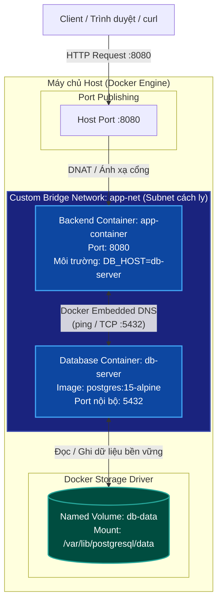

# BÁO CÁO THỰC HÀNH - BÀI 4
## CHỦ ĐỀ: THIẾT LẬP CUSTOM NETWORK & NAMED VOLUME BẰNG DOCKER CLI

- **Môn học**: IT209 - Quản lý Phiên bản và Hợp tác Mã nguồn / Linux Administration
- **Học viên**: Trần Trí Dương ([`duongtran1702`](https://github.com/duongtran1702))
- **Email**: `duong170226@gmail.com`
- **Mã lớp**: IT209
- **Đường dẫn bài nộp trên GitHub**: [`homework/session_10/ex4/`](https://github.com/duongtran1702/IT209_Session_10_bai_4)
- **Tệp kịch bản chính**: [`commands.sh`](commands.sh)

---

## 1. MỤC TIÊU BÀI TẬP

1. **Custom Bridge Network (`app-net`)**:
   - Thiết lập mạng cầu nối tùy chỉnh (User-defined Bridge Network) cho phép các container cùng tham gia phân giải tên miền nội bộ (**Embedded DNS Resolution**) qua Service/Container Name thay vì phụ thuộc vào địa chỉ IP tĩnh dễ thay đổi.
2. **Named Volume (`db-data`)**:
   - Thiết lập khối lưu trữ có định danh độc lập với vòng đời của Container, gắn kết (mount) vào thư mục dữ liệu chuẩn của cơ sở dữ liệu PostgreSQL (`/var/lib/postgresql/data`).
3. **Kết nối cụm 2 Container**:
   - Giao tiếp giữa Container **Backend Web API** (`app-container`) và **Database Server** (`db-server`) hoàn toàn nội bộ qua mạng `app-net`.
4. **Kiểm thử Data Persistence (Bảo toàn dữ liệu)**:
   - Thêm dữ liệu vào Database ➔ Xóa cứng container DB (`docker rm -f db-server`) ➔ Tái tạo Container DB mới gắn cùng Volume `db-data` ➔ Xác minh 100% dữ liệu không bị thất thoát.

---

## 2. CẤU TRÚC THƯ MỤC

```text
homework/session_10/ex4/
├── commands.sh          # Kịch bản Bash thực thi toàn bộ thao tác theo yêu cầu
├── run-commands.ps1     # Kịch bản PowerShell bổ trợ cho môi trường Windows
├── Dockerfile           # Đóng gói ứng dụng Backend Web API (Node.js Alpine)
├── server.js            # Mã nguồn Backend Web API kết nối PostgreSQL
├── package.json         # Cấu hình dependency (pg driver)
├── .dockerignore        # Bỏ qua node_modules và tệp thừa khi build
└── README.md            # Tài liệu báo cáo hướng dẫn chi tiết
```

---

## 3. KIẾN TRÚC HỆ THỐNG VÀ LUỒNG DỮ LIỆU



---

## 4. BẢNG TỔNG HỢP CÁC LỆNH DOCKER CLI (TRONG `commands.sh`)

| STT | Thao tác | Câu lệnh Docker CLI | Giải thích kỹ thuật |
| :---: | :--- | :--- | :--- |
| **1** | Tạo Custom Bridge Network | `docker network create --driver bridge app-net` | Tạo subnet riêng biệt có cơ chế tự động phân giải DNS nội bộ giữa các container theo tên định danh. |
| **2** | Tạo Named Volume | `docker volume create db-data` | Khởi tạo ổ đĩa có tên quản lý bởi Docker daemon, tách rời dữ liệu khỏi vòng đời sống chết của container. |
| **3** | Build Image Backend | `docker build -t backend-api:v1 .` | Đóng gói mã nguồn REST API vào image nhẹ trên nền `node:18-alpine` có tích hợp `ping` (`iputils`). |
| **4** | Chạy Container Database | `docker run -d --name db-server --network app-net -v db-data:/var/lib/postgresql/data -e POSTGRES_DB=appdb -e POSTGRES_USER=appuser -e POSTGRES_PASSWORD=secretpassword123 postgres:15-alpine` | Chạy DB ngầm (`-d`), gắn vào `app-net`, mount volume `db-data`, thiết lập credentials qua biến môi trường. |
| **5** | Chạy Container Backend | `docker run -d --name app-container --network app-net -p 8080:8080 -e DB_HOST=db-server -e DB_PORT=5432 -e DB_NAME=appdb -e DB_USER=appuser -e DB_PASSWORD=secretpassword123 backend-api:v1` | Chạy Backend ngầm, tham gia `app-net`, ánh xạ cổng `8080:8080`, truyền hostname `db-server`. |
| **6** | Xóa cứng Container DB | `docker rm -f db-server` | Hủy diệt ép buộc (`-f`) container DB để giả lập sự cố máy chủ sập hoặc nâng cấp container. |
| **7** | Tái tạo Container DB | `docker run -d --name db-server --network app-net -v db-data:/var/lib/postgresql/data ... postgres:15-alpine` | Dựng container mới hoàn toàn nhưng gắn lại đúng volume `db-data` cũ để khôi phục dữ liệu. |

---

## 5. HƯỚNG DẪN THỰC THI VÀ KIỂM TRA

### 5.1. Thực thi tự động toàn bộ qua kịch bản

Tại thư mục `homework/session_10/ex4/`:

**Trên Linux / macOS / Git Bash / WSL:**
```bash
chmod +x commands.sh
./commands.sh
```

**Trên Windows PowerShell:**
```powershell
.\run-commands.ps1
```

---

### 5.2. Các bước kiểm tra độc lập theo tiêu chí bài tập

#### Bước 1: Xác minh Network `app-net` đã được tạo
```bash
docker network ls | grep app-net
```
**Kết quả mong đợi:**
```text
abcdef123456   app-net   bridge    local
```

#### Bước 2: Xác minh Named Volume `db-data` đã được tạo
```bash
docker volume ls | grep db-data
```
**Kết quả mong đợi:**
```text
local     db-data
```

#### Bước 3: Kiểm tra cấu hình chi tiết mạng `app-net` (Inspect)
```bash
docker network inspect app-net
```
**Kết quả mong đợi:**
Trong mục `"Containers"`, hiển thị cả 2 container `db-server` và `app-container` cùng tham gia với địa chỉ IP nội bộ (ví dụ: `172.18.0.2` và `172.18.0.3`).

#### Bước 4: Kiểm tra DNS Resolution nội bộ từ Backend Container sang Database Container
```bash
docker exec -it app-container ping -c 2 db-server
```
**Kết quả mong đợi:**
```text
PING db-server (172.18.0.2): 56 data bytes
64 bytes from 172.18.0.2: seq=0 ttl=64 time=0.082 ms
64 bytes from 172.18.0.2: seq=1 ttl=64 time=0.075 ms

--- db-server ping statistics ---
2 packets transmitted, 2 packets received, 0% packet loss
round-trip min/avg/max = 0.075/0.078/0.082 ms
```
> **Đánh giá**: Container `app-container` giải mã chính xác hostname `db-server` thành địa chỉ IP nội bộ `172.18.0.2` thông qua Docker Embedded DNS server tích hợp sẵn trong Custom Bridge Network.

---

### 5.3. Xác thực kiểm thử tính toàn vẹn dữ liệu (Data Persistence Verification)

#### Bước A: Thêm dữ liệu ban đầu vào container `db-server`
```bash
docker exec -i db-server psql -U appuser -d appdb -c "
CREATE TABLE IF NOT EXISTS inventory (id SERIAL PRIMARY KEY, item_name VARCHAR(100), quantity INT);
INSERT INTO inventory (item_name, quantity) VALUES ('Docker Named Volume Test', 10), ('Network DNS Resolved', 20);
"
```

Truy vấn kiểm tra dữ liệu hiện tại:
```bash
docker exec -i db-server psql -U appuser -d appdb -c "SELECT * FROM inventory;"
```
**Kết quả:**
```text
 id |        item_name         | quantity 
----+--------------------------+----------
  1 | Docker Named Volume Test |       10
  2 | Network DNS Resolved     |       20
(2 rows)
```

#### Bước B: Xóa cưỡng chế (Xóa cứng) container Database
```bash
docker rm -f db-server
```

Kiểm tra trạng thái container:
```bash
docker ps -a | grep db-server
# (Không còn container nào tên db-server)
```

#### Bước C: Khởi chạy Container Database mới gắn cùng Volume `db-data`
```bash
docker run -d \
  --name db-server \
  --network app-net \
  -v db-data:/var/lib/postgresql/data \
  -e POSTGRES_DB=appdb \
  -e POSTGRES_USER=appuser \
  -e POSTGRES_PASSWORD=secretpassword123 \
  postgres:15-alpine
```

#### Bước D: Xác minh dữ liệu không bị mất sau khi tái tạo
```bash
docker exec -i db-server psql -U appuser -d appdb -c "SELECT * FROM inventory;"
```
**Kết quả hiển thị:**
```text
 id |        item_name         | quantity 
----+--------------------------+----------
  1 | Docker Named Volume Test |       10
  2 | Network DNS Resolved     |       20
(2 rows)
```
> **Kết luận**: Mặc dù container `db-server` ban đầu bị hủy diệt hoàn toàn, toàn bộ dữ liệu bảng `inventory` và các chỉ mục PostgreSQL vẫn tồn tại nguyên vẹn 100% nhờ việc mount Named Volume `db-data` vào `/var/lib/postgresql/data`.

---

### 5.4. Kiểm tra phản hồi qua Backend Web API
Truy vấn kiểm tra kết nối qua REST API:
```bash
curl http://localhost:8080/health
```
**Kết quả trả về:**
```json
{
  "status": "UP",
  "service": "Backend Web API",
  "database": "CONNECTED",
  "db_host": "db-server"
}
```

Truy vấn lấy danh sách bản ghi:
```bash
curl http://localhost:8080/api/items
```
**Kết quả trả về:**
```json
{
  "success": true,
  "total": 2,
  "data": [
    { "id": 1, "item_name": "Docker Named Volume Test", "quantity": 10 },
    { "id": 2, "item_name": "Network DNS Resolved", "quantity": 20 }
  ]
}
```

---

## 6. PHÂN TÍCH SO SÁNH KỸ THUẬT

### Custom Bridge Network vs. Default Bridge Network

| Đặc điểm | Default Bridge Network (`bridge`) | Custom Bridge Network (`app-net`) |
| :--- | :--- | :--- |
| **DNS Resolution** | **Không hỗ trợ** (chỉ giao tiếp bằng địa chỉ IP tĩnh hoặc dùng `--link` cũ đã deprecated) | **Hỗ trợ tự động** thông qua Docker Embedded DNS Engine (phân giải theo container name) |
| **Cách ly bảo mật** | Tất cả container không khai báo network sẽ vào chung, dễ xung đột | Cô lập hoàn toàn, chỉ container nào tham gia mới thấy nhau |
| **Gắn kết động** | Không thể ngắt/gắn lại khi container đang chạy | Có thể dùng `docker network connect/disconnect` linh hoạt |

---

## 7. DỌN DẸP TÀI NGUYÊN (CLEANUP)

Sau khi hoàn tất quá trình nghiệm thu, chạy các lệnh sau để thu hồi tài nguyên:
```bash
# Dừng và xóa các container
docker rm -f db-server app-container

# Xóa Named Volume
docker volume rm db-data

# Xóa Custom Network
docker network rm app-net

# Xóa image vừa build
docker rmi backend-api:v1
```
